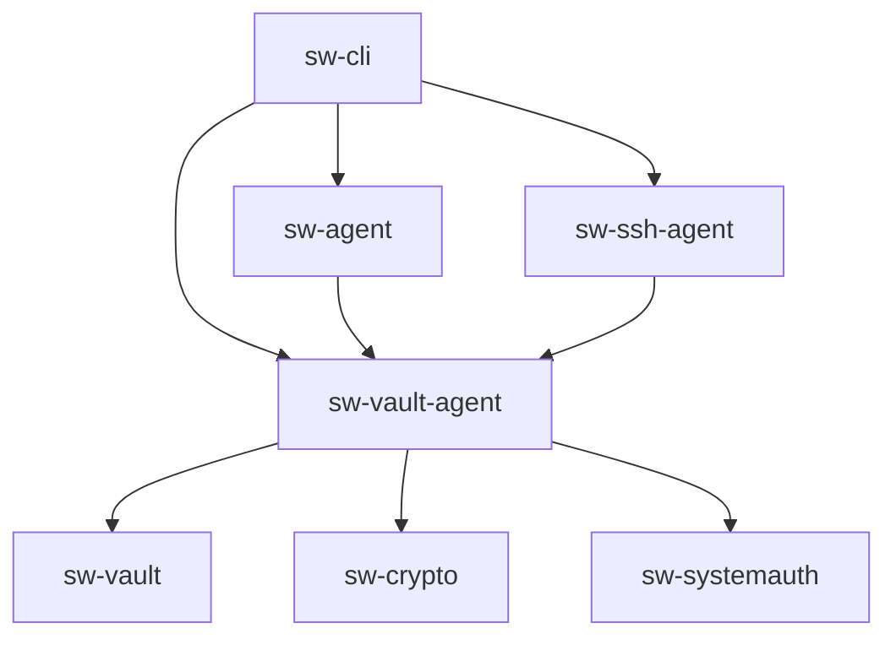

# ADR-0007 — Propiedad y Ciclo de Vida de `VaultAgentServer` (`sw-vault-agent`)

- **Estado:** Aceptado
- **Fecha:** 2026-11-10
- **Autores:** SilverWarden Architecture Team
- **Relacionado con:** Principio P2 (El núcleo no depende del adaptador), Fase 1.3, Fase 1.4

---

## 1. Contexto

Durante el análisis y pruebas de integración de la Fase 1.3 se identificaron dos problemas arquitectónicos críticos:

1. **Bug de los dos `VaultStore` en memoria:**
   Al iniciar el agente con `silverwarden agent start`, el daemon (`sw-agent`) creaba un `VaultAgentServer` con su propia instancia de `VaultStore` (Instancia A), mientras que el SSH Agent (`sw-ssh-agent`) utilizaba una variable global o constructor separado `for_shared_agent()` creando una segunda instancia de `VaultStore` (Instancia B). Cuando el usuario desbloqueaba el daemon vía IPC, se desbloqueaba la Instancia A; el SSH agent consultaba la Instancia B (que permanecía bloqueada y vacía), fallando silenciosamente o requiriendo sincronizaciones duplicadas.

2. **Inversión de dependencias violando P2:**
   `sw-agent` (parte del núcleo del daemon) dependía directamente de `sw-ssh-agent` (un adaptador de transporte de protocolo SSH) únicamente porque el struct `VaultAgentServer` estaba definido dentro de `sw-ssh-agent`. Esto violaba la regla de dependencias limpias: el núcleo nunca debe depender de un adaptador de protocolo de entrada.

---

## 2. Decisión

1. **Creación del crate neutral `sw-vault-agent`:**
   Se extrae `VaultAgentServer`, sus errores (`SshAgentError`), estructuras de claves (`SshKeySummary`), y proveedores de aprobación (`ApprovalProvider`, `DefaultApprovalProvider`, `MockApprovalProvider`) a una nueva biblioteca intermedia en el workspace: `crates/sw-vault-agent`.

2. **Composición única (Single Instance per Process):**
   Se elimina todo singleton global (`SHARED_VAULT_AGENT`) y `for_shared_agent()`. En su lugar, el punto de entrada de la aplicación (`sw-cli`) crea exactamente **una** instancia de `Arc<VaultAgentServer>`, inyectando esa misma instancia tanto en `AgentDaemon` / `AgentState` de `sw-agent` como en `SshAgentServer` de `sw-ssh-agent`.

3. **Inversión de dependencias:**
   - `sw-agent` depende de `sw-vault-agent`.
   - `sw-ssh-agent` depende de `sw-vault-agent`.
   - `sw-agent` ya **no** depende de `sw-ssh-agent`.

---

## 3. Alternativas Descartadas

- **Mantener singleton `SHARED_VAULT_AGENT` en `sw-ssh-agent`:**
  - *Descartada:* Los singletons globales ocultan el flujo de dependencias, complican la concurrencia y los tests en paralelo, y no resuelven la violación de P2 (`sw-agent` seguiría dependiendo de `sw-ssh-agent`).
- **Mover `VaultAgentServer` adentro de `sw-agent`:**
  - *Descartada:* Forzaría a `sw-ssh-agent` a depender de todo `sw-agent` (incluyendo handlers IPC, DBus, biometría, notificaciones de escritorio, etc.), acoplando indebidamente el adaptador SSH al daemon.
- **Fusionar `sw-ssh-agent` con `sw-agent`:**
  - *Descartada:* Destruiría la modularidad hexagonal y la capacidad de compilar o probar el SSH Agent como un adaptador desacoplado.

---

## 4. Consecuencias y Grafo de Dependencias

### Positivas:
- **Cero divergencia de estado:** El daemon y el SSH agent operan sobre el mismo `VaultStore` en memoria; desbloquear uno desbloquea ambos de inmediato.
- **Cumplimiento estricto de P2:** El núcleo no depende de ningún adaptador SSH.
- **Testabilidad pura:** `VaultAgentServer` y sus políticas de aprobación se prueban unitariamente en `sw-vault-agent` sin necesidad de levantar sockets Unix ni procesos `ssh-add`.

### Grafo resultante:

`sw-agent` y `sw-ssh-agent` son hermanos independientes; ninguno depende del otro.

