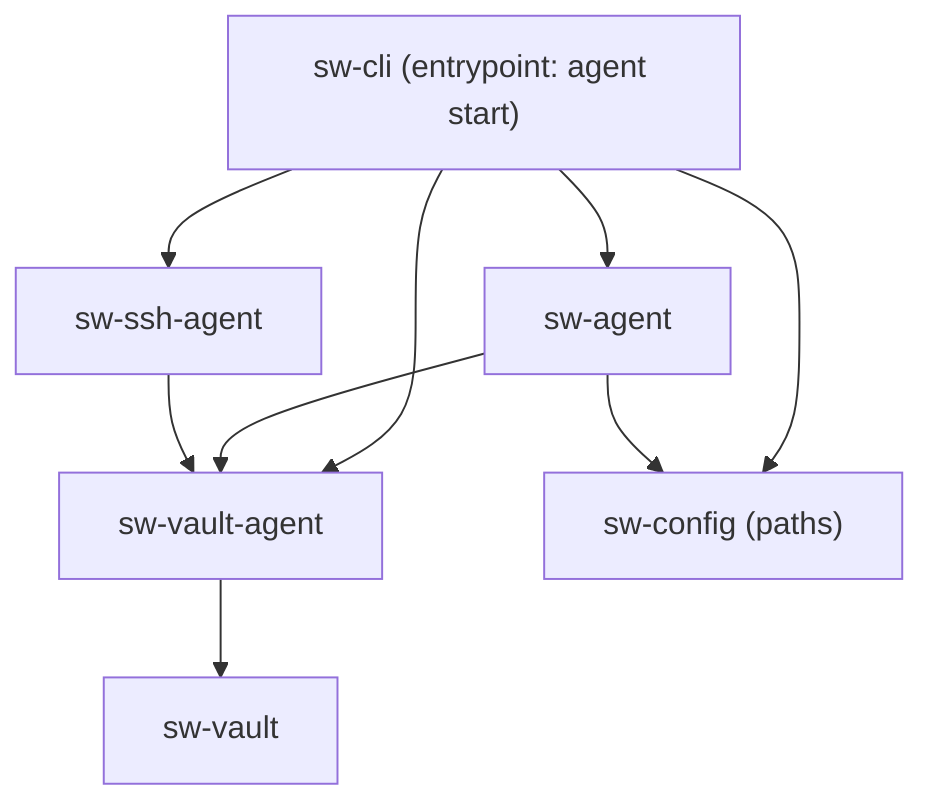

# ADR-0008 — Entrypoint del Daemon y Centralización de Rutas

- **Estado:** Aceptado
- **Decisión:** **Opción A** (`sw-cli agent start` es el entrypoint del daemon y la dependencia `sw-cli → sw-agent` se acepta)
- **Fecha:** 2026-11-13
- **Autores:** SilverWarden Architecture Team
- **Relacionado con:** Fase 1.5, ADR-0007, `crates/sw-config/src/paths.rs`

---

## 1. Contexto (Decisión: Opción A)

La Fase 1.5 centralizó las rutas de sockets en `crates/sw-config/src/paths.rs`
(`default_socket_path`, `default_ssh_agent_socket_path`, `socket_path_from_home`,
`ssh_agent_socket_path_next_to`). El objetivo era que ningún crate hardcodease
`~/.silverwarden.sock` y que la ruta fuera inyectable en tests.

Al documentar el cambio apareció una afirmación incorrecta: que mover la ruta a
`sw-config` eliminaba la dependencia `sw-cli → sw-agent`. No la elimina.
`sw-cli` sigue llamando a `sw_agent::run_agent` desde `silverwarden agent start`,
como demuestra:

```text
$ cargo tree -p sw-cli | rg sw-agent
├── sw-agent v0.1.0 (/home/hermes/Proyectos/SilverWarden-RS/SilverWarden-Rs/crates/sw-agent)
```

Quedaban dos formas de resolver esa dependencia:

- **Opción A:** `sw-cli agent start` sigue siendo el entrypoint y `sw-cli` depende
  de `sw-agent`. La dependencia se acepta y se documenta.
- **Opción B:** `sw-agent` se convierte en un binario real que sirve el socket, y
  `sw-cli` lo ejecuta como subproceso.

---

## 2. Decisión

**Se elige la Opción A.**

1. `silverwarden agent start` (`crates/sw-cli/src/commands/agent.rs`) es el
   entrypoint documentado del daemon.
2. Ese comando:
   - crea **una** instancia de `Arc<VaultAgentServer>`;
   - lanza `sw_agent::run_agent` en una tarea;
   - lanza `sw_ssh_agent::SshAgentServer` en otra tarea con la misma instancia;
   - espera `Ctrl+C` o el fallo de cualquiera de las dos tareas;
   - elimina los sockets al salir.
3. `crates/sw-agent/src/main.rs` sigue existiendo, pero **no** es el entrypoint
   documentado: solo arranca el daemon principal, sin SSH agent ni limpieza de
   sockets. Se conserva como utilidad de desarrollo.
4. Las rutas viven en `sw_config::paths`, no en `sw-cli` ni en `sw-agent`.
5. La dependencia `sw-cli → sw-agent` se acepta: `sw-cli` es el compositor de la
   aplicación y por definición conoce a sus adaptadores.

---

## 3. Alternativas Descartadas

- **Opción B — `sw-agent` como binario real ejecutado por `sw-cli`:**
  - *Descartada:* obligaría a duplicar en `sw-agent` el arranque del SSH agent, el
    manejo de `Ctrl+C` y la limpieza de sockets; además rompería la composición
    única de `VaultAgentServer` (ADR-0007), porque el subproceso tendría su propio
    `VaultStore` y volvería el bug de los dos stores.
- **Mantener la afirmación de que la ruta elimina la dependencia:**
  - *Descartada:* es falsa. `cargo tree -p sw-cli | rg sw-agent` muestra `sw-agent` como
    dependencia normal, y ocultarlo solo confunde a quien lea el plan.
- **Mover `run_agent` a `sw-cli`:**
  - *Descartada:* mezclaría el ciclo de vida del daemon con la capa de comandos y
    haría que `sw-cli` dependiera de toda la implementación interna de `sw-agent`.

---

## 4. Consecuencias y Grafo de Dependencias

### Positivas

- **Un solo entrypoint:** el usuario ejecuta `silverwarden agent start` y obtiene
  daemon IPC + SSH agent con el mismo `VaultStore`.
- **Rutas inyectables:** `sw-config::paths` acepta `Option<&Path>` para tests, sin
  leer `$HOME` de forma implícita.
- **Dependencia honesta:** `sw-cli → sw-agent` queda declarada y justificada, no
  escondida.

### Negativas

- `sw-cli` arrastra el peso de `sw-agent` al compilarse, aunque el usuario solo
  quiera usar `login` o `unlock`.
- `crates/sw-agent/src/main.rs` puede confundir: hay que dejarlo marcado como
  herramienta de desarrollo, no como daemon.

### Grafo resultante



`sw-agent` y `sw-ssh-agent` siguen siendo hermanos independientes; el único que
los compone es `sw-cli`.

---

## 5. Fecha de Revisión

Se revisará esta decisión tras el cierre de la Fase 5 (documentación de arquitectura y `README.md`, tarea `5.2.3`) o si en una versión futura se separa el daemon en un binario de sistema independiente gestionado exclusivamente por `systemd`.
